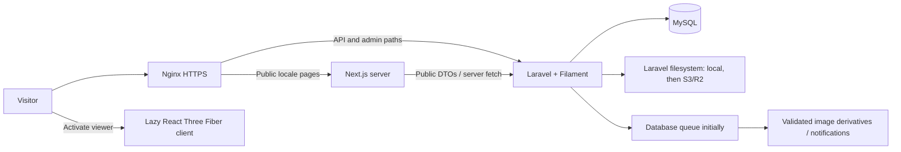

# TIME STONE — Milestone 0 proposal

Date: 12 October 2026. Status: discovery and architecture proposal; awaiting approval before Milestone 1.

## 1. Scope and confirmed decisions

This milestone reviews the supplied references and prototype and proposes the implementation. No Next.js or Laravel application, database migration, dependency installation, or production deployment is included.

- Primary conversion: request a quotation; WhatsApp is a secondary contact path. No checkout or payment gateways.
- Confirmed by the user: provide Arabic, French and English from Milestone 1, including translated homepage/navigation and Arabic RTL. French remains the default language.
- Confirmed by the user: use clearly labeled temporary assets from the mockups for now. These are design illustrations, not evidence of actual products, company facilities, or completed projects.
- Preserve the existing `prototype/` as the working baseline. Integrate its reusable engine during Milestone 3 rather than rewriting it.
- Follow milestones 0–9, with explicit approval between milestones. Production infrastructure changes need separate explicit approval.
- Unknown company facts and product measurements remain editable placeholders in previews. Hide unverified claims and unsupported controls on the published website.

## 2. Workspace and asset inventory

The root currently contains `design-references/` and `prototype/`. There is no existing Next.js frontend or Laravel API to extend, and no supplied backend schema.

All seven supplied PNG references were opened and visually inspected:

| Reference in `design-references/` | Dimensions | Page and observed composition |
| --- | --- | --- |
| `Timeless Stone_ Taza Marble Landing Page.png` | 1536 × 1024 | Desktop homepage: transparent header; quarry hero; left story rail; stone block in the center; texture selector at right; six-item benefit strip; five collection cards; split quarry/process section. The image ends at that section. |
| `Timeless Stone for Modern Architecture.png` | 798 × 1971 | Mobile homepage: logo/language/menu; tall hero with stacked heading and CTAs; block and swatches at right; four-item benefit strip; two-column categories with full-width Custom Designs; quarry narrative; four application cards; WhatsApp CTA. |
| `Time Stone Natural Stone Collection.png` | 1024 × 1536 | Composite desktop/mobile catalogue: quarry banner; desktop filter sidebar; search, sorting and category chips; three-column desktop grid; mobile search/filter trigger, horizontal chips, two-column grid and load-more action; custom solution CTA and process cards. |
| `Taza Beige Limestone Product Showcase.png` | 1536 × 1024 | Desktop product: quarry-backed header and breadcrumbs; gallery rail + large slab viewer; title/details/specifications in middle; quotation and documents sidebar; finish swatches; application cards; bottom custom solution band. |
| `Taza Beige Limestone Product Showcase (1).png` | 801 × 1962 | Mobile product: header and breadcrumbs; viewer first; horizontal gallery; 3D/texture/dimension/AR toolbar; title/details; finishes; specifications; application strip; wide quote and PDF actions. |
| `TIMES STONE Applications Showcase.png` | 1536 × 1024 | Desktop applications: architectural hero; six application tiles; four project cards; dark benefit/CTA band. No separate mobile reference. |
| `Carved in Stone_ Our Story.png` | 1536 × 1024 | Desktop About: quarry hero; introduction/image/quality columns; statistics band; four process cards; architectural contact band. No separate mobile reference. |

The 798/801 px mobile images are raster artwork, not confirmed CSS viewport widths or device screenshots. The catalogue file contains two compositions; it must be compared as two separate reference regions.

Other available assets:

- `prototype/public/textures/`: three sample stone textures (`marble_rock_01.jpg`, `marble_01.jpg`, `granite_tile_02.jpg`). The prototype README attributes these to Poly Haven under CC0; retain attribution and verify original license records before release. These are demo materials, not a verified TIME STONE inventory.
- `prototype/public/favicon.svg`: prototype icon; not an approved production brand asset.
- `prototype/qa-output/material-lab.png`: existing prototype screenshot, not a new screenshot or proof of the website design.
- No separate approved logo artwork, original quarry photographs, real product galleries, production GLB models, technical PDFs, process video, or confirmed project portfolio was supplied.
- Do not use whole mockup screenshots as website sections. Temporary crops must be labeled; replace with original assets before production acceptance. No AI image generation is needed for Milestone 0.

## 3. Design system proposal

The compositions consistently use charcoal text, warm white surfaces, limestone neutrals, amber/gold controls, editorial serif headings and clean sans-serif body text. Large photographs provide most of the visual weight. Rounded corners are restrained except on buttons and selected pills.

These are provisional implementation tokens inferred visually, not measured source design values. Exact fonts, brand colors and component measurements were not supplied.

| Token | Proposed value / usage |
| --- | --- |
| Canvas | `#FAF8F5`, warm off-white |
| Surface | `#FFFFFF`; subtle alternate `#F1ECE4` |
| Ink | `#171B20`; muted copy `#555B63` |
| Border | `#DFD7CC`, thin dividers and card outlines |
| Primary button | `#E5BC78` with dark ink; use a darker hover state |
| Accent text | `#80602F` on light surfaces; pale gold on dark photographs |
| Dark band | `#22211E` with a photographic background when suitable |
| Heading family | Self-hosted Noto Serif for French/English; Noto Naskh Arabic for Arabic; confirm availability/license during foundation setup |
| Body family | Self-hosted Noto Sans and Noto Sans Arabic; local system fallbacks |
| Type scale | Body 16 px, line height 1.5–1.65; small labels 12–14 px; section headings roughly 30–44 px; hero roughly 40–64 px, fluid with viewport |
| Spacing | 4/8/12/16/24/32/48/64/96 px scale; 20 px mobile gutters, 32–48 px desktop gutters |
| Layout | Main content max-width about 1280 px; catalogue/sidebar composition up to 1440 px; adaptive grids rather than fixed reference-image widths |
| Corners | Cards/viewer 6–10 px; controls 8 px; pill shape only for category chips and suitable CTAs |
| Controls | Minimum 44 × 44 px touch targets; 2 px visible focus outline with adequate contrast |
| Motion | 160–240 ms control transitions; restrained transform/opacity transitions; no forced scrolling |

Gold text in the mockups is sometimes too light against white. Retain the palette while darkening text and focus indicators as necessary to meet WCAG AA; validate actual contrast after implementation. The proposed typefaces are substitutes pending approval, not identified fonts from the artwork.

### Shared components and responsive behavior

- `SiteHeader`, desktop navigation, mobile menu, locale selector, quote CTA and a complete footer. Header changes to an opaque surface on scroll; anchors account for its height.
- `PageHero`, `SectionHeading`, `CategoryCard`, `ProductCard`, `ApplicationCard`, `ProjectCard`, `ProcessSteps`, `QuoteCallout`, media/gallery, form controls and breadcrumbs.
- Preserve image aspect ratios and explicit dimensions. Use responsive source sizes, overlay scrims for legibility, and meaningful alt text for content images.
- Start with mobile layouts. At approximately 768 px add intermediate grids; enable full navigation/sidebar around 1024 px only when content fits. At wide widths use the full product composition; collapse to two columns before one column rather than squeezing three panels.
- Mobile categories/catalogue remain two columns where readable; narrower widths can use one column. Filters open an accessible drawer with Apply, Clear, result count, focus containment and focus restoration.
- Product mobile order: viewer → thumbnails/controls → title and details → finishes/specifications → applications → documents/related products. Keep an accessible quote action readily available without covering content or device safe areas.
- Arabic uses logical CSS properties and `dir="rtl"`. Mirror directional arrows and layout as appropriate; preserve readable LTR phone numbers, dimensions and file names. Avoid letter spacing on Arabic text.
- Menus, dialogs, sliders, gallery and quote flow must work by keyboard. Provide named camera reset/zoom/rotation controls alongside mouse/touch orbit.
- Reduced motion removes scroll choreography and auto-rotation. Static preview remains useful with WebGL unavailable, JavaScript unavailable, or 3D not activated.

### Inconsistencies and proposed resolutions — approval requested

| Issue in supplied artwork | Proposed resolution |
| --- | --- |
| Desktop has six hero benefit items; mobile has four. | One ordered CMS collection, reflowing on mobile; publish only substantiated statements. Avoid silently dropping approved content. |
| The desktop homepage reference ends earlier than the mobile reference and the written section list. | Preserve the shown hero/collection/quarry compositions. Extend below them with introduction, featured products, craftsmanship, applications, verified quality content and final quote/footer using the same component system. These extensions need approval. |
| “Quarry” is in reference navigation but not a required standalone page. | Initially link to the quarry/process section on About; no separate quarry route without additional scope. |
| Categories mix materials (limestone/marble) and formats (tiles/blocks/custom). | Separate stone type from category and physical format. Keep the reference category cards as merchandising categories; allow each product to offer multiple formats. Avoid forcing a material to imply one shape. |
| Hearts, Popular sorting and availability appear without supporting business requirements/data. | Omit wishlist and stock badges/filters. Default to Featured, with newest and name sorting; no fabricated popularity metric. |
| Mobile gallery shows other stones as if they belong to the product. | Show only verified images for that product; alternatives are explicitly labeled and appear only if supplied. |
| Five product finishes appear; the prototype supports three simulations. | Keep honed/polished/rough simulations initially. Do not silently map brushed, bush-hammered or sandblasted to rough; add accurate presets and imagery only with supporting assets and validation. |
| Product AR buttons appear, but the required viewer has no AR feature. | Omit AR controls for now. AR is a separately scoped feature, not a disabled promise. |
| Ratings/reviews, 24h response, export/sustainability claims and numerical specifications are shown. | Remove until verified. Do not reproduce reference density, strengths, absorption, dimensions, counts or stock as real data. |
| About shows “20+”, “500+”, “15+”, “100+”; Applications calls illustrations “Real Projects”. | Hide unverified statistics. Label temporary architectural images as illustrative; publish a portfolio only with confirmed attribution/rights and project facts. |
| Reference quote buttons emphasize WhatsApp/email, whereas the brief requires stored requests. | Primary action opens the website quote form and stores it on confirmed success. Secondary WhatsApp action opens an encoded draft; email notifications remain optional. |
| No footer, contact/quote layouts, or mobile About/Applications designs are supplied. | Propose restrained layouts derived from approved tokens and shared components; verify them separately, without claiming reference-level fidelity. |

## 4. Page inventory and implementation plan

Locale routes use `/{locale}` with `fr`, `en`, `ar`; `/` redirects to `/fr`. Keep route segments and product slugs stable across locales initially to simplify links and avoid duplicate identity; translate visible labels and metadata independently.

| Route / surface | Layout and content | First milestone |
| --- | --- | --- |
| `/fr` (and `/en`, `/ar`) | Homepage sections described above; Arabic, French and English mock fixtures until CMS integration, with RTL for Arabic. Initial immersive block may use static preview and restrained movement; reusable live viewer and cinematic choreography follow in M3. | M1; 3D in M3, CMS in M6 |
| `/{locale}/products` | Hero, sidebar/drawer, search, category chips, stone-type/finish/color/application filters, sorting, paginated grid, custom CTA. | M2 |
| `/{locale}/products/{slug}` | Reference-based product layout, gallery, on-demand 3D, configuration, specifications, related products, PDFs and quote actions. | M3 |
| `/{locale}/applications` | Hero, application tiles, illustrative or verified projects, relevant-product links, quotation CTA. Mobile stacks/reflows desktop components. | M4 |
| `/{locale}/applications/{slug}` | Minimal reusable application detail with descriptive content and paginated related products; project entries can remain cards/sections, no separate project routes initially. | M4 |
| `/{locale}/about` | Introduction, quarry/manufacturing narrative, process, verified quality statements and contact CTA. Omit unverified statistics. | M4 |
| `/{locale}/contact` | Confirmed contact channels, address if supplied, and clear project-enquiry CTA; no invented map location. | M4 |
| `/{locale}/quote` | One product configuration per request initially; can also accept a general project enquiry. Contact, delivery, quantity/unit and project details; success/error states. | M4 interface; M6 persistence |
| `/{locale}/privacy` | Client-approved privacy notice for enquiry handling; editable page content. | M7 |
| `/admin` | Filament authentication, dashboard, resources, structured content, settings and quotes. Unlocalized route; localized admin labels can follow configured language. | M5 |
| Preview / not-found / loading / error states | Protected draft previews; public 404s without revealing drafts; useful loading/error and empty catalogue states. | Alongside each feature |

In M1–M4, development fixtures are explicitly temporary and `noindex`. All three languages, locale switching, translated interface text and Arabic RTL begin in M1 and apply to each public page as it is built. Use authored, reviewable translations; no automatic machine-translation service. M7 performs final translation completeness, RTL regression and localized SEO checks across the dynamic website. Links become functional when their milestone arrives; do not display working-looking forms or download/video buttons that have no action.

## 5. Architecture and proposed project structure

```text
time-stone/
  apps/
    web/                    Next.js App Router, TypeScript, Tailwind
      src/app/[locale]/     Public pages, server-rendered content
      src/components/       Shared UI; isolated client-side 3D area
      src/lib/              API adapter, localization and metadata
    api/                    Laravel API + Filament; MySQL authority
      app/                  Models, policies, FormRequests, Resources, jobs
      database/             Migrations, factories and test seeders
      tests/                Focused feature and unit tests
  packages/
    shared-types/           Public DTO types only; introduced with API contracts
  prototype/                Preserved standalone baseline and existing tests
  design-references/        Supplied visual source of truth
  docs/                     This proposal and milestone reports
  deployment/               Nginx/services/backup configuration in M9
```

Create directories only when needed. Use npm workspaces for JS packages and Composer separately for Laravel; no monorepo orchestrator or Docker requirement. Keep the viewer inside `apps/web` initially; share its component with the Filament preview through a protected embedded frontend route when M5 needs it. A separate viewer package is justified only if there is a real second consumer.

### Technology baseline and version policy

- Proposed baseline: Node.js 24 LTS; Next.js 16 App Router; compatible React 19; TypeScript; Tailwind 4; Laravel 13 on PHP 8.3+ (prefer a supported PHP 8.4 build on the VPS); Filament 5; MySQL 8.4 LTS.
- Treat this as a candidate set. Resolve exact supported patch versions, peer dependencies and security advisories during each foundation milestone, commit lockfiles, then run builds/tests. No new packages are installed in M0.
- Preserve Three.js `0.180.0` and compatible R3F/Drei from the prototype initially; do not upgrade the engine at the same time as moving it. The current lockfile resolves React 19.3.0, R3F 9.8.1, Drei 10.7.9, Vite 7.3.7 and Tailwind 4.3.3; declared ranges in `package.json` differ from resolved patches.
- GSAP/ScrollTrigger is conditional on an approved M3 choreography that needs it; ordinary transitions do not need another dependency.
- Local verification used Node 23.1.0, npm 10.9.0 and PHP 8.3.6. Node 23 is EOL; repeat foundation verification on the chosen LTS runtime before treating it as the production baseline.
- Next.js, Laravel and Filament requirements were checked against official sources listed below. Full Composer/npm compatibility is still unverified until actual project dependency resolution.

### Responsibilities, request flow and deployment boundaries



- Laravel owns publishing rules, translations/fallbacks, product options, upload validation, quotations and authorization. Next.js renders public DTOs; frontend validation improves feedback but never replaces server validation.
- Public read endpoints need no user account. Filament uses Laravel session authentication, CSRF protection and policies. No customer accounts or token-auth system is required by this scope.
- Same-origin deployment: public pages → Node; `/api/v1/*` and `/admin/*` → Laravel. Laravel also needs its actual Livewire script/update/upload routes, generated Filament/Vite assets, public media routes and health endpoint routed correctly. Do not assume proxying `/admin` alone is sufficient. Pin exact paths from generated route/asset output in M9.
- PHP-FPM executes only Laravel's trusted `public/index.php`; never execute uploads or arbitrary `.php` paths. All other files remain outside the public web root unless intentionally published.
- Start with filesystem storage and database-backed queue/cache where adequate. Add Redis only after measured benefit. Production media jobs need a supervised worker; scheduler only for actual scheduled maintenance.
- Next.js public content uses explicit bounded caching (proposed 5-minute safety TTL). Successful admin publication emits an after-commit invalidation event; an authenticated server-only callback clears affected Next tags. Use signed, replay-resistant requests; credentials never enter client JS. Drafts/PII never enter shared caches. M6 tests confirm updates and deletions invalidate related listings, pages and metadata.
- Draft preview uses a short-lived signed token validated server-side, HttpOnly preview session, `no-store` and `noindex`; never an unauthenticated `?draft=1` API bypass. A separate same-origin authenticated preview bridge carries only validated 3D config to the Filament iframe; restrict origins/message types and do not transmit admin session credentials to JS.

### Multilingual strategy

- Store independently editable translation rows with a unique `(entity_id, locale)` key. Keep technical numeric values and identifiers shared; translate names, descriptions, labels, alt text and metadata.
- Proposed fallback: requested translation field → French field. Return the actual source locale/fallback flag; tag fallback text with its true language. Required publication fields must exist in French.
- Never index an entire untranslated duplicate locale page just because it can render French fallback. Mark it `noindex` and omit it from hreflang/sitemap until reviewed translations satisfy publication requirements.
- Locale switching preserves product identity and catalogue filters; return to that locale's collection if the current detail is unavailable. Filter values are stable keys, not translated labels.

## 6. Existing 3D prototype assessment

The current app is a standalone React/Vite JavaScript project, not a Next.js component package. Source and direct dependencies were reviewed; source code was not changed.

| Existing file | Reuse and integration boundary |
| --- | --- |
| `prototype/src/stone.js` | Reuse centimeter-to-meter validation, beveled geometry, six-face UV rules, finish presets and explicit disposal. Convert to typed inputs without changing the engine; add versioned serialized configuration. |
| `prototype/src/images.js` | Reuse JPEG/PNG signature/size checks, image preparation, 2048 px color / 1024 px bump caps and URL cleanup for browser previews. Server must independently decode/validate uploads and create persistent derivatives. |
| `prototype/src/StoneViewer.jsx` | Reuse R3F scene, PBR lighting, camera fitting, orbit/zoom/reset, screenshot and lazy GLB exporter. Mount only in a client island; server rendering must never execute canvas or DOM APIs. |
| `prototype/src/App.jsx` | Reuse configuration behavior, stale-upload cancellation, local errors, fullscreen fallback and control semantics. Replace the standalone layout with public product controls and authenticated admin preview. |
| `prototype/tests/stone.test.js` | Preserve geometry, preset, validation and disposal regression tests during integration. |
| `prototype/tests/browser.html` | Preserve browser texture-processing, GPU replacement and standard GLB re-import acceptance checks; automate with Playwright as part of M3. |

Verified from source: slab/block/tile, dimensions 0.5–500 cm, honed/polished/rough, roughness/bump, texture scale/rotation, non-metal stone, local upload, orbit/zoom/reset, auto-rotation, fullscreen fallback, PNG and GLB export. Idle rendering uses `frameloop="demand"`; DPR is capped at 1.5. Geometry/materials/textures dispose on replacement, and stale uploads are discarded. These statements describe implementation, not proof of all UI behavior on every device.

### Gaps and risks to address in M3/M5

1. No stored product or configuration, GLB import workflow, editable texture offset, alternate-product texture model or measured normal maps. Texture offsets are currently hardcoded per face. Add only the required controls and persisted fields.
2. `StoneViewer` eagerly loads in the prototype. Split it from public content and load only on activation; use a real image fallback rather than a blank canvas.
3. Auto-rotation uses continuous frames even if offscreen; there is no visibility/reduced-motion gate. Pause when hidden/offscreen, and disable motion when requested. Consider capture-only drawing-buffer preservation after measuring PNG export, without breaking exports.
4. `ContactShadows` uses `frames={1}`: changes in dimensions may require a controlled shadow refresh. Test actual behavior before changing it.
5. There are twelve per-face texture wrappers; disposal is implemented, but real mobile GPU memory/latency still needs measurement. The small granite demo crop is low detail.
6. Browser image checks occur after decoding for the 80-megapixel limit; decoding can be expensive. Production uploads need byte, dimension, decompression and processing-time limits outside the browser as well.
7. Existing finish changes trigger material shader recompilation when needed. Preserve this behavior and test rough → polished after replacement.
8. Finishes simulate appearance. Bump is inferred from luminance, not measured relief. Front images may stretch across mismatched aspect ratios. Side and rear textures are approximate. Display these facts near the viewer and in saved/exported metadata.
9. GLB exports embed color textures and meter dimensions; bump is preview-only because the export has no standard bump channel. Environment, lights and studio are not part of the product export. Test clearcoat/materials, UV transforms and re-import; do not imply exported lighting matches the studio.
10. Manually uploaded GLB must pass structural/resource limits. Require self-contained assets, reject external URIs/network fetches, cap triangles/textures/dimensions, and enforce timeouts. Do not treat a `.glb` extension or header alone as complete validation. Label it “supplied 3D model”; it is not independently verified survey geometry.

### Proposed saved 3D configuration (v1)

```json
{
  "schema_version": 1,
  "mode": "procedural",
  "shape": "slab",
  "dimensions_cm": { "width": 120, "height": 180, "thickness": 3 },
  "texture_media_id": "<validated-media-id>",
  "model_media_id": null,
  "finish_key": "honed",
  "roughness": 0.55,
  "bump_intensity": 0.22,
  "texture": { "scale": 1, "rotation_deg": 0, "offset_x": 0, "offset_y": 0 },
  "preview_media_id": "<static-preview-id>"
}
```

The numbers above are prototype demonstration values, not product specifications. In uploaded-model mode require `model_media_id`; do not distort a real model to arbitrary dimensions without an explicit supported transform. Validate config enums and numeric bounds on the backend. Viewer state can be experimental; quote selections must separately match actual sellable options or be flagged as custom requests.

## 7. Database schema proposal

MySQL is the source of truth. Use foreign keys, timestamps, explicit allowed fields and policies. All dimensions and quantities use decimal columns; no floating point for quote measurements. No pricing, order or payment tables are required.

| Tables | Principal fields and relationships |
| --- | --- |
| `users` | Laravel auth fields, active/admin permission; no public registration. Explicit policies govern catalogue, media, pages, settings and quote access. |
| `categories`, `category_translations` | Unique stable slug, image reference, order, active flag; translated name/description/SEO. One primary category per product initially. |
| `stone_types`, `stone_type_translations` | Unique key, translated label; independent material classification such as limestone or marble. |
| `finishes`, `finish_translations`; `colors`, `color_translations` | Stable keys and order; translated labels; color swatch value validated separately. Finishes may have optional verified preview presets. |
| `products`, `product_translations` | Stable slug, category/type FKs, publication state, featured/order, verified origin, draft/published timestamps; translated title/description/SEO; structured verified technical specs with value/unit/source. |
| `product_finishes`, `product_colors` | Unique product-option pairs; available options independently managed, never inferred from photographs. |
| `product_formats` | Product FK, shape key (`slab`, `block`, `tile`, `custom`), default/min/max dimensions in cm, permitted thicknesses, unit options (`piece`, `m2`, `m3`), custom-size permission. Availability is confirmed by staff; no stock claim. |
| `product_3d_configs` | Product/format FK, schema version, procedural/uploaded mode, texture/model/preview media FKs, dimension defaults and bounded material/UV JSON. One config per configured format initially. |
| `media`, `media_translations`, `product_media` | Disk + relative object key; MIME, bytes, dimensions, checksum, processing/visibility state, metadata/provenance; translated alt/caption; product relation with role, finish and sort order. Derivatives use relative keys in structured metadata. |
| `applications`, `application_translations`, `application_product` | Stable slug, image/order/active, localized heading/body/SEO; unique related-product pairs. |
| `projects`, `project_translations`, `project_media`, `project_product`, `application_project` | Optional verified project portfolio: title/location/description/rights/evidence, publication state and image/product/application associations. Illustrative projects cannot masquerade as completed client work. |
| `pages`, `page_translations`, `page_sections`, `page_section_translations` | Stable page key, SEO, ordered typed sections, visibility, validated structure and referenced media/entity IDs. Each section has explicit translatable fields; whitelist known section types and link targets. |
| `site_settings` | Typed grouped settings and locale content: logo/favicon/media references, contacts, WhatsApp, socials, defaults, footer and SEO. Secrets stay in environment/secret storage, not public settings. |
| `quotation_requests`, `quotation_items`, `quotation_status_events` | UUID request identity/reference; contact/delivery/locale/project details and status; product/config selection with immutable label/spec/config snapshots; quantity/unit; private status history and operator. One item in initial UI, structure permits later multi-product quotes without a cart now. |
| Laravel framework tables | Sessions, cache, jobs and failed jobs when selected; standard migrations only as required. |

### Constraints and integrity

- Translation tables: unique `(parent_id, locale)`, supported-locale validation. Slugs/option keys unique in their domain. Pivot tables: unique FK pairs and reverse lookup indexes.
- Products: indexes for `(status, published_at, id)`, category/status and stone_type/status; index featured ordering if used. Media-role lookup indexes and quote `(status, created_at, id)` index. Search initially uses bounded, paginated database queries; verify query plans at representative volume before adding an external search service.
- Prevent category deletion with products via policy and restrictive FK; reassign in one transaction when explicitly requested. Deactivate/archive products instead of losing quote references.
- Quotes retain immutable snapshots even if products/options/translations change; nullable live product references with `SET NULL` can preserve history on a later approved purge. Quote status is server-controlled and never accepted from the public form.
- Physical media deletion is blocked while referenced by products/pages/projects/settings/configs; clear orphaned draft uploads only after a safe retention window. Delete records/files through controlled actions with authorization.
- Technical measurements/specifications require provenance/verification before public exposure. Hide empty facts rather than displaying fake zeroes or mockup values.
- Catalogue updates, relationship changes and configuration saves are transactional. Media processing jobs are idempotent; failed uploads remain unpublished and recoverable.
- Protect enquiry PII: authorized admin access only, no public listing/read endpoint, no shared cache, no PII in URLs/logs, and encrypted backups. Set retention and privacy text with the client before launch.

## 8. API contract proposal

Use `/api/v1`, JSON, Laravel API Resources, snake_case keys, ISO 8601 timestamps and stable identifiers. Public DTOs expose only published/active content and safe media URLs. Internal storage keys and private files remain server-side.

| Method and endpoint | Contract |
| --- | --- |
| `GET /api/v1/site?locale=fr` | Public navigation/footer/contact/SEO defaults only; never environment values, admin details or credentials. |
| `GET /api/v1/pages/{key}?locale=fr` | Published typed sections and resolved safe references; missing/unpublished pages return 404. |
| `GET /api/v1/categories?locale=fr` | Active categories and published-product counts. |
| `GET /api/v1/products?locale=fr&category=limestone&stone_type=limestone&finish=honed&color=beige&application=interior-flooring&q=taza&sort=featured&page=1&per_page=12` | Paginated product cards and bounded facet counts; defaults 12 per page, maximum 48; sort allowlist `featured`, `newest`, `name_asc`, `name_desc`. Search length and filter keys validated. |
| `GET /api/v1/products/{slug}?locale=fr` | Product details, ordered gallery, verified specs/options, 3D config and document links. Related products limited to a small page-sized selection. |
| `GET /api/v1/applications?locale=fr` | Published application cards and bounded featured projects. |
| `GET /api/v1/applications/{slug}?locale=fr&page=1` | Detail content with paginated related products. |
| `POST /api/v1/quotation-requests` | Validate and persist one request transactionally, return 201 with a non-sensitive reference. Optional queued notification after commit. No public read/list endpoint. |
| Protected preview endpoint | Session/signed-preview authorization, narrow draft DTO, `no-store`; not accessible through public endpoints. |
| Server-only content invalidation | Signed after-commit callback to Next.js, validated entity/tag allowlist and replay protection; no arbitrary path/URL revalidation supplied by visitors. |

Filter facets should use published data and predictable semantics: different filter groups combine with AND; initially one selected key per group. Category counts are live, not copied from the artwork. Keep the URL as the canonical catalogue state; refresh, back/forward and shared links reproduce the same selection. A changed filter resets page to 1. Ordinary paginated links remain crawlable even if mobile offers progressive load-more.

Example listing envelope (illustrative shape, no invented product):

```json
{
  "data": [],
  "meta": { "current_page": 1, "per_page": 12, "total": 0, "last_page": 1 },
  "links": { "prev": null, "next": null },
  "locale": { "requested": "fr", "fallback": "fr" }
}
```

Example quote payload (placeholder values):

```json
{
  "locale": "fr",
  "customer": { "name": "<name>", "email": "<email>", "phone": "<phone>" },
  "delivery": { "country_code": "MA", "location": "<city/site>" },
  "project_details": "<requirements>",
  "items": [{
    "product_id": "<published-product-id>",
    "format_id": "<allowed-format-id>",
    "finish_id": "<allowed-finish-id>",
    "dimensions_cm": { "width": "120.00", "height": "180.00", "thickness": "3.00" },
    "quantity": "50.00",
    "unit": "m2",
    "custom_dimensions_requested": false
  }],
  "privacy_acknowledged": true,
  "website": ""
}
```

- This is a proposed payload, not a live endpoint. The example dimensions/quantity are demonstrations. General project enquiries may have an empty `items` array but require project details. Named product requests require an allowed product/format/finish, positive bounded quantity and compatible unit; piece quantities are integers. No trusted names, prices or specifications come from the browser.
- Require name, email, delivery country/location and privacy acknowledgement; phone is optional unless the client chooses otherwise. Validate lengths, emails, units, decimal bounds and relation ownership server-side. Custom sizes must be explicitly allowed or recorded as a staff-reviewed custom request rather than represented as standard availability.
- Public submission accepts no files initially. Add validated project attachments only if separately requested.
- Baseline abuse controls: request/body limits, honeypot, per-IP throttle (proposed 5 submissions/10 minutes, configurable), minimum elapsed form time and duplicate-submit protection. Escalate to a challenge only if abuse justifies it. Do not persist rejected spam as successful enquiries.
- Use an `Idempotency-Key` for retry safety; same key/payload returns the original reference, conflicting payload returns 409. Keep keys scoped/expired appropriately and never return saved PII. Persist and snapshot on the server before success UI; notification failure does not erase an accepted request.
- Standard errors: 422 `{message, errors: {field: [message]}}`, 429 with `Retry-After`, 404 for missing/unpublished content, generic 500 without stack traces. Localize validation using supported locales. Never expose whether an unpublished product exists.
- WhatsApp uses the configured validated international number and URL-encoded selected details. Label the action “Open WhatsApp”; link opening is not evidence of message delivery or a stored website quotation. Do not insert customer contact/PII into URLs unnecessarily.
- Admin CRUD remains inside Filament using authenticated Laravel actions/policies; do not duplicate it as a broad admin REST API unless a demonstrated integration requires that.

## 9. Media/storage, security and performance plan

- Laravel filesystem disks own storage. Persist `disk` and relative `key`; resolve URLs at response time. Moving to S3/R2 requires copying objects with their keys/metadata and configuring the disk/base URL/CORS/cache policy, not rewriting product logic.
- Originals, drafts and quarantine uploads are private. Generate public optimized derivatives only after validation/publication; private PDFs/models use authorized delivery where needed. Public technical PDFs download with correct MIME/disposition and `nosniff`.
- Image uploads: inspect MIME/content, decode safely, cap bytes/pixels/time, strip unnecessary metadata, create responsive WebP/AVIF/JPEG derivatives and save dimensions/alt text. JPEG/PNG initial texture support preserves prototype behavior. GLB and PDF validation are separate pipelines with limits and quarantine; no SVG/HTML upload execution.
- Server-render catalogue/product text and metadata; mount client components only for filters/forms/gallery interaction and active viewer. Never ship all products or the admin bundle to a public page.
- Hero starts as a responsive LCP image with fixed dimensions. Load 3D after user action; use capped DPR and optimized textures, reuse/dispose resources, pause offscreen and provide static fallbacks. Avoid multiple active canvases when homepage/viewer sections coexist.
- Eager-load required relationships with selected fields; paginate catalogue and project/product relations; test query counts and explain plans. Cache only public data and invalidate after publication changes.
- Validate link protocols and destinations; sanitize CMS rich text; escape ordinary fields. Whitelist CORS origins only where needed. Use secure HttpOnly session cookies, CSRF on authenticated state-changing routes, rate-limited admin login and policies for every resource.
- Apply CSP compatible with the viewer/admin, HSTS after HTTPS verification, and sensible framing rules (only the explicitly required same-origin preview). Secrets never use `NEXT_PUBLIC_*` variables.
- Performance goals remain Lighthouse 95+ and field p75 LCP ≤2.5s, INP ≤200ms, CLS ≤0.1. These are targets, not measurements or guarantees. Field p75 needs actual traffic; local Lighthouse cannot prove it.

## 10. Milestone plan and acceptance gates

| Milestone | Scope and required evidence before approval |
| --- | --- |
| 0 — Discovery | This proposal; all references inspected; prototype source/dependencies reviewed; existing tests/build checked; recorded limitations and pending decisions. |
| 1 — Foundation/homepage | Next.js/TS/Tailwind, Arabic/French/English shell and homepage, working locale selector, Arabic RTL, shared components and labeled fixtures, responsive behavior and reduced motion; production build, targeted navigation/locale/RTL/accessibility checks, desktop/mobile screenshots and initial measured performance report or explicit measurement limitation. |
| 2 — Catalogue | Paginated mock adapter matching the API DTO, URL filters/search/sort, responsive sidebar/drawer; tests for filter combinations, reset, paging and back/forward; empty/error states. |
| 3 — Detail/3D | Reuse typed prototype engine and exports, static fallback, product controls, approved hero choreography, optional imported GLB; geometry/material/resource/export regression tests, real browser round-trip and responsive screenshots; measured viewer loading/rendering costs. |
| 4 — Public pages/quote UI | Applications/About/contact/quote layouts, validation and success/error designs; mock submissions visibly remain demo-only; responsive screenshots and navigation tests. |
| 5 — API/admin | Laravel/Filament/MySQL, secure auth/policies, media/config/content/catalogue/quote management, drafts and preview; targeted backend authorization/validation/CRUD/upload/translation tests; API contract fixtures. No production data modification. |
| 6 — Dynamic integration | Replace fixtures, real quote persistence, cache/revalidation, admin preview and publication; end-to-end admin-to-public changes, stale cache/deletion checks and quote snapshot/idempotency tests. |
| 7 — Locales/SEO/security | Final completeness review of FR/EN/AR dynamic translations, RTL and language-switching regression, metadata/hreflang/sitemap, accurate structured data, privacy and accessibility/security checks; never fake review/offer schema. |
| 8 — Readiness | Representative production-mode Lighthouse/mobile throttling, accessibility/browser regression, WebGL fallback/reduced motion and physical-device checklist; measured optimizations, known limitations and release checklist. |
| 9 — Deployment | Reviewable Nginx/services/HTTPS/migration/backup/restore/rollback configuration first; actual VPS changes only after explicit authorization and target confirmation; smoke tests and monitoring evidence. |

Testing remains targeted to each milestone. Visual comparisons must use known reference regions, matched desktop/mobile proportions and documented screenshot viewport sizes. Check real readable layouts at 390/430 px and intermediate widths; do not stretch 798 px artwork into a claim of pixel-perfect mobile matching. Physical iOS/Android touch/GPU checks are separate from browser emulation.

## 11. Milestone 0 verification report

### Implemented / files changed

- Created only `docs/milestone-0-proposal.md`: architecture, reference analysis, page inventory, provisional tokens, schema, API contracts, 3D reuse plan, risks and milestones.
- Prototype source, dependencies and reference assets were preserved. Running the existing build regenerated ignored `prototype/dist/` output; running Vite can refresh its local dependency cache. These are verification artifacts, not website implementation.

### Executed checks

From `C:\Users\DELL 7420\Desktop\time-stone\prototype`:

| Command / inspection | Result |
| --- | --- |
| `npm.cmd test` | PASS: 6 tests, 0 failures. Covers meter geometry, invalid dimensions, face UV proportions, PBR presets, disposal and upload signatures/size. |
| `npm.cmd run build` | PASS: 595 modules transformed, build completed in 12.37 seconds. Large-chunk advisory remains. |
| Existing `/tests/browser.html` on a loopback Vite server, inspected in the in-app browser | PASS: all 11 acceptance checks; real JPEG/PNG processing, resizing/orientation, GPU cleanup across 16 replacements, object URL cleanup, GLB container/embedded textures and standard GLTFLoader round-trip dimensions. Captured console inspection returned no warnings/errors. This harness does not cover every main-app control or physical mobile behavior. |
| `node --version`, `npm.cmd --version`, `php --version` | Node 23.1.0 / npm 10.9.0 / PHP 8.3.6. These describe the local environment only. |
| Lockfile/package/source inspection | Resolved versions and reuse/gaps documented above. No new dependency installation. |
| Reference visual inspection | All 7 images inspected; dimensions read from PNGs. No frontend/reference screenshot comparison yet because M1 has not started. |

### Visual and performance evidence

- No newly implemented website desktop/mobile screenshots exist at M0. The supplied PNGs are design inputs and the prior prototype screenshot is historical evidence only.
- Browser test setup initially encountered a restricted loopback socket and an unreachable tab. A loopback-only server with approved network access responded HTTP 200, and a fresh in-app browser tab completed the existing checks. No firewall settings or external hosting were changed.
- Measured prototype bundle: main JS 1,215.30 kB raw / 344.21 kB gzip; lazy GLTF exporter 35.25 / 10.51 kB; CSS 27.11 / 6.91 kB. These are bundle sizes, not Lighthouse results or Core Web Vitals.
- No deployed-page Lighthouse, real-user vitals, physical-device tests or production security assessment was performed in this milestone.

### Open business inputs and assumptions

Only the first two decisions above have been confirmed. Remaining input can arrive in the relevant milestone:

- Before final content/publication: legal/company name, address/contact/WhatsApp, verified quarry origin/ownership, production/process facts, certifications/claims, real project permissions, original logo/photo rights and approved copy/translations.
- Before product/admin acceptance: representative real products, actual category/type/format relationships, sellable finishes, thickness/dimension bounds, units, technical data/PDFs and staff workflow.
- Before quote launch: recipient email if notifications are wanted, privacy notice/retention, optional phone requirement and custom-size handling.
- Before deployment: domain, VPS target/access, Ubuntu/PHP/MySQL resources, SMTP/object-storage choice, backup destination/retention and restore ownership. No credentials needed for M0.

### Approval gate / next milestone

Approve the proposed structure, design reconciliation and M1 scope, or identify the changes required. Next is M1: the frontend foundation and responsive Arabic, French and English homepage with Arabic RTL and labeled temporary assets. M1 does not include the catalogue, full product viewer integration, Laravel/admin or deployment.

**Stop here. Do not begin Milestone 1 without the user's approval.**

## 12. Official technical references checked during discovery

- [Next.js App Router installation](https://nextjs.org/docs/app/getting-started/installation) and [Next.js 16 upgrade/runtime requirements](https://nextjs.org/docs/app/guides/upgrading/version-16).
- [Laravel 13 releases and PHP/support requirements](https://laravel.com/framework/docs/13.x/releases).
- [Filament 5 installation](https://filamentphp.com/docs/5.x/introduction/installation); [Filament support package constraints](https://raw.githubusercontent.com/filamentphp/filament/5.x/packages/support/composer.json) include Laravel 13 contracts. This does not replace full Composer resolution.
- [Node.js release status](https://nodejs.org/en/about/previous-releases): Node 24 is LTS; the installed Node 23 is EOL.

Source code and local tests are the authority for the existing prototype. Online version guidance is time-sensitive and must be rechecked when installing each application.
