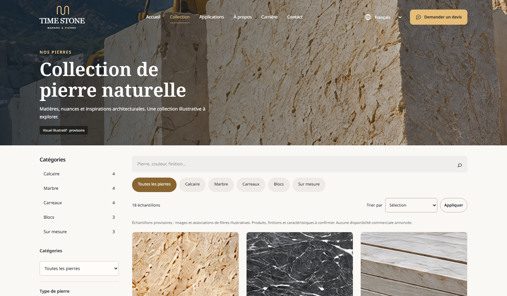
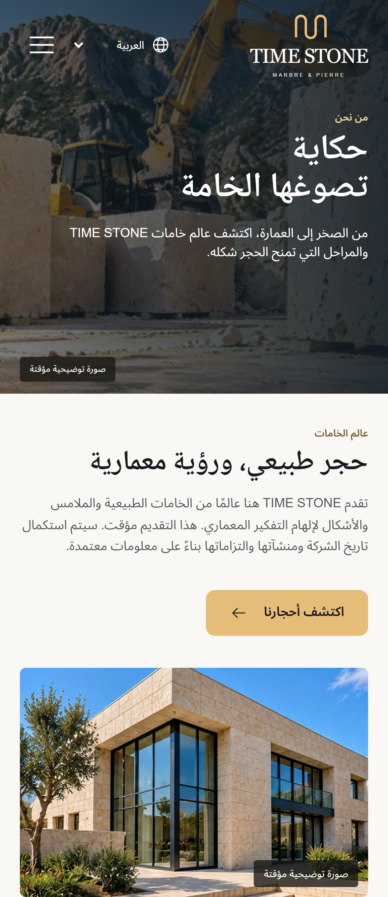

# Milestone 6 — Corrective verification report

13 October 2026. **Corrected functionality and regressions pass; mobile homepage LCP exceeds the target in every measured mobile homepage run.** This is a local verification report, not deployment approval. No Milestone 7 work or deployment was performed.

The complete [corrective report](milestone-6-corrections.md) contains root causes, exact changed files, every skip, before/after timings, environment/method, screenshots and evidence. The [previous audit](qa/milestone-6-final/corrections/before-report.md) is preserved, including its 91 passed / 9 failed / 20 skipped result and original traces.

## Executed checks

| Check | Final result | Evidence |
| --- | --- | --- |
| Laravel / isolated MySQL | 67 passed; 375 assertions; zero failures/errors/skips; 42.554 s | [JUnit](qa/milestone-6-final/corrections/backend-final-junit.xml) |
| Next production build | Passed; compiled 4.7 s; 16 generated pages; localized routes remain SSR | [Build](qa/milestone-6-final/corrections/build-final.log) |
| Separate TypeScript | Passed, exit 0 | [Log](qa/milestone-6-final/corrections/typecheck-final.log) |
| Standalone 3D | 8 passed; zero failures/skips; 0.940 s | [Log](qa/milestone-6-final/corrections/standalone-3d-final.log) |
| Full Playwright, one worker, no retries | 118 passed; zero failures/flaky; 20 intentional skips; 27.71 min | [Complete JSON](qa/milestone-6-final/corrections/playwright-full.json) / [case/skip list](qa/milestone-6-final/corrections/browser-summary.json) |
| Actual painted banner stacking | 108 checks; FR/EN/AR, 320/390/430/768/1024/1536 px | [Screenshots/index](qa/milestone-6-final/corrections/screenshots-index.json) |
| Publication, media replacement, 3D sync and revocation | Passed; actual GLB textures/UV transforms verified | [Workflow](qa/milestone-6-final/corrections/end-to-end.json) |
| Quotation persistence / Filament / immutable snapshots | Passed | [Database evidence](qa/milestone-6-final/corrections/persistence-evidence.json) |
| Real validation, throttling and duplicate protection | 201/200/409/422/201/429; Retry-After 59 s | [HTTP results](qa/milestone-6-final/corrections/http-quotations.json) |
| Timeout + throttled retry recovery | Same key/reference; no false success or browser storage | [Recovery](qa/milestone-6-final/corrections/network-recovery.json) |
| Scoped cleanup / integrity | All original rows/files/env hashes preserved; owner active | [Integrity](qa/milestone-6-final/corrections/cleanup.json) |

PHPUnit used `time_stone_test`, array cache/session, test mail and the existing `_test` database guard. No development-database refresh or seeder was executed. Browser workflows used strictly identified disposable QA records on the local business database.

## Corrections

- Fixed responsive picture-wrapper stacking for heroes and CTAs, preserving gradients, text, composition and RTL. Added painted-element browser checks.
- Kept eight-second deadlines. Measured API/app/DB/media concurrency, removed three unused homepage reads and scoped serialized-media cache keys by origin. Added safe server-side diagnostics.
- Isolated concurrent PHP on 8011 and Next production on 3011, with private cached Laravel configuration and isolated OPcache. Caching corrected observed intermittent MissingAppKey errors in the new threaded runtime. Existing development services and `.env` files remain intact.
- Added quality-90, no-upscale responsive WebP derivatives; preserved originals and existing variants. Retained the high-quality hero and all architectural imagery.
- Updated real-data browser assertions, preserved all filter/navigation/focus assertions and corrected confirmation focus after React commit.
- Preserved valid Retry-After through Laravel and Next, localized the duration and preserved uncertain-submission input/key protection.

No dependencies, schema migrations, engine rewrites, unsupported features, redesign or new animation were introduced.

## Performance

**FR mobile, warm processes / reset browser storage:** 4.359–5.030 s; median 4.695 s versus original-audit median 4.889 s (4.0% change). The ≤2.5 s target is not met in either run. Small local samples are not field p75.
**AR mobile, warm processes / reset browser storage:** 4.955–5.572 s; median 5.263 s versus original-audit median 5.267 s (0.1% change). The ≤2.5 s target is not met in either run. Small local samples are not field p75.

French and Arabic desktop homepage LCP are **1.893 s / 1.883 s**. The representative French mobile product page measures **4.064 s**; the mobile catalogue measures **6.390 s**, worse than the previous one-off 4.213 s result. These one-off route measurements retain warmed processes but do not prime content caches, so they are flagged as uncontrolled-cache observations rather than a matched performance comparison. The catalogue result remains a performance concern, not a passing performance sign-off.

Every final cold/warm/desktop/representative result is listed in the [corrective report](milestone-6-corrections.md), with [raw combined measurements](qa/milestone-6-final/corrections/performance-combined.json) and [resolved lab settings / observed traces](qa/milestone-6-final/corrections/performance-diagnostics.json). Cold means restarted audit PHP/Next and six forgotten lab-origin content-cache entries; configuration cache and OS/MySQL buffers remain warm. The two FR/AR mobile warm runs retain application caches/processes but reset browser storage; other representative runs do not explicitly prime route-content caches. The browser process is reused within each two-run warm series. Local Lighthouse is not production Core Web Vitals.

The post-cache direct transport probe completed all 156 requests successfully without increasing deadlines. The [full Next SSR/media probe](qa/milestone-6-final/corrections/ssr-media-path.json) reproduced eight 8-second timeouts in 30 requests against the old 3001/CLI-8000 preview and none in 30 against corrected 3011/cached-Apache-8011 (maximum 4,249.66 ms). This compares the complete build/runtime combinations, not only PHP servers. The original serialized PHP server remains available; it is not a production concurrency model.

The supplementary [CTA paint probe](qa/milestone-6-final/corrections/cta-paint.json) adds 54 checks. The existing shared project band has no assigned CMS image, so its configured fallback background is tested; no imagery was invented.

## Screenshots and working evidence

Additional desktop/mobile/RTL/public/product captures are in the [index](qa/milestone-6-final/corrections/screenshots-index.json). The [real 3D demonstration capture](qa/milestone-6-final/corrections/viewer-ar-390.png), exported GLB files and viewer resource/heap counters accompany the workflow evidence. Hardware GPU memory and physical mobile performance were not measured.

Report links and scoped plaintext/client secret checks are recorded in [report-validation.json](qa/milestone-6-final/corrections/report-validation.json). No configured secret value is emitted by that check.

## Remaining limitations and security

- The requested ≤2.5-second mobile LCP target remains unresolved under the documented unchanged mobile lab configuration. Quality and design were preserved; there is no clean performance sign-off.
- The one-off mobile catalogue LCP is 6.390 s; its cache state is uncontrolled and this worse measured result requires further performance investigation before sign-off.
- Historical 503 root causes cannot be reconstructed completely from generic old logs. Measured serialization and the separately reproduced threaded-runtime configuration failure are distinguished from inference. Timings and successful bounded probes are not production-capacity guarantees.
- Twenty intentional project-gated skips remain, individually listed in the corrective report. No failing case was skipped, retried automatically or counted as a pass from another viewport. Exploratory interrupted runs and their failures are retained separately.
- Client JS contains neither the configured proxy secret nor internal API origin. Publication checks, private originals, validation, authorization, last-owner protection, idempotency and immutable numeric/configuration snapshots remain covered by backend tests. This is scoped verification, not penetration testing or a dependency-vulnerability assessment.
- A controlled trusted reverse proxy is still required before trusting forwarded client headers. Lab trust is loopback-only. TLS, production cookie/proxy settings, distributed abuse resistance, CAPTCHA, SMTP delivery, backup/restore, retention/privacy approval and full manual assistive-technology review remain unverified or deferred. Database confirmation implies no email/WhatsApp delivery or order/payment.
- Global WAMP has the pre-existing malformed `post_max_size=M`; the isolated runtime and test commands use valid limits without editing global PHP configuration. Real workflow uploads remain below 2 MB; backend image validation/bounds tests pass, but this corrective pass does not establish a large-file production upload benchmark.
- Procedural previews remain illustrative; optional uploaded GLB models/AR and authenticated draft live previews remain deferred. Replacing shared media preserves the media ID but changes its bytes; historical binary texture immutability is not claimed.
- Private audit credentials were deleted. Retained traces can contain synthetic form values or credentials for deleted QA accounts; permanent owner credentials were not recorded. The ignored audit configuration cache contains existing secrets and must remain private/outside public distribution.

All original business-row and file hashes were checked after scoped cleanup: 18 products, 50 media, one quotation and the active permanent owner remain. Only additive responsive derivative metadata/files persist. **Stop at Milestone 6 and await explicit approval.**
