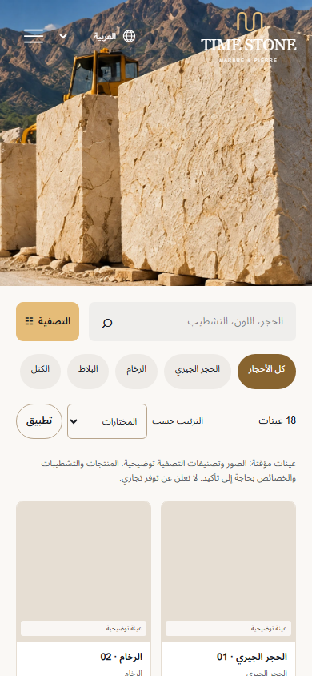

# Milestone 6 — Final verification audit

Archive note: historical audit content is retained; evidence links are adjusted for this archive location.

Audit date: 13 October 2026. Scope: verification of the existing Next.js, Laravel/Filament, MySQL, media, quotation and procedural 3D integration. No deployment or Milestone 7 work was performed. Application source and business data were not redesigned or migrated during this audit. Disposable QA records were used for real-browser workflows and removed afterward.

## Decision

**Verification has unresolved failures; this is not a clean release sign-off.** Backend tests, production compilation, TypeScript and standalone 3D tests pass. The browser results below retain every failure and skip. Mobile LCP and the banner stacking defect remain unresolved acceptance issues for a claim that all acceptance criteria pass.

## Environment and executed checks

Windows local environment; PHP 8.3.6; MySQL 8.3.0; Node 24; Next.js 16.4.0; Playwright Chromium; Lighthouse 13.5.0. Next production output `.next-audit-m6` was served on `127.0.0.1:3001`, with the existing Laravel development server on `127.0.0.1:8000`. The user’s development server on port 3000 was preserved. Browser device sizes are emulated, not physical devices.

| Check | Actual result | Evidence |
| --- | --- | --- |
| Full Laravel PHPUnit suite | 65 passed; 347 assertions; 0 failures/errors/skips; 239.806 s | [JUnit](../backend-junit.xml) / [case list](../backend-summary.json) |
| Next production build | Passed; compiled in 36.2 s; all 16 generated pages completed; localized content routes remain dynamic SSR | [build.log](../build.log) |
| Separate TypeScript check | Passed, exit 0 | [typecheck.log](../typecheck.log) |
| Standalone prototype/integrated 3D tests | 8 passed; 0 failed/skipped; 2.296 s | [verification-summary.json](../verification-summary.json) |
| Real HTTP Next quotation boundary | 6/6 rejected with expected statuses; no upstream submission or database writes | [next-boundary.json](../next-boundary.json) |
| Complete Playwright suite, one worker, no automatic retries | 91 passed; 9 failed; 20 skipped; 0 flaky; 58.65 min | [full JSON](../playwright-full.json) / [log](../playwright-full.log) |

PHPUnit ran with `DB_CONNECTION=mysql`, `DB_DATABASE=time_stone_test`, array cache/session and test mail transport. `Tests/TestCase.php` rejects non-MySQL connections and database names without `_test`; Laravel config cache was absent. Browser/HTTP integration probes deliberately used the local development database, with a pre-audit ID baseline and scoped cleanup; they did not use production data or endpoints.

Executed commands (Node and npm used the installed Node 24 runtime):

```text
cd apps/api
php -d post_max_size=128M -d memory_limit=256M -d xdebug.mode=off vendor/bin/phpunit --colors=never --log-junit ../../docs/qa/milestone-6-final/backend-junit.xml
cd ../..
NEXT_DIST_DIR=.next-audit-m6 npm run build
npm run typecheck
node --test prototype/tests/stone.test.js tests/stone-engine.test.mjs
QA_BASE_URL=http://127.0.0.1:3001 QA_ADMIN_LOCALE_CREDENTIALS=<private QA file> playwright test --workers=1
php -d post_max_size=128M .tools/final-http-quotation-audit.php
node .tools/final-integration-qa.mjs
node .tools/final-integration-resume.mjs
node .tools/final-quotation-recovery.mjs
node .tools/final-visual-diagnostic.mjs
QA_BASE_URL=http://127.0.0.1:3001 QA_OUTPUT_DIR=<evidence directory> node scripts/performance.mjs <locale> <device> <runs>
```

Shell notation above is abbreviated for readability; actual logs and JSON record executed results. The initial partial browser run was stopped when the audit preview was found to have inherited `SITE_URL=http://127.0.0.1:3000`. The preview was restarted with its correct port-3001 origin, without changing user environment files. That initial partial run is separate from the complete result table: [playwright-initial-preview.log](../playwright-initial-preview.log). The first HTTP probe had a mutable test-header reuse error; its corrected clone-based run passed. Both [initial probe](../http-quotations-initial-harness.json) and [corrected probe](../http-quotations.json) are retained; this was a harness correction, not a duplicate-protection code change.

## Real publication, media, 3D and quotations

The admin probe was corrected in two places: the finish choice is scoped to its custom dropdown (avoiding a hidden native option), and actual embedded GLB texture hashes replace an unreliable fresh-network-event assumption. The persisted QA workflow was resumed, without creating another product or quotation. The original failures remain in [end-to-end-initial-harness.json](../end-to-end-initial-harness.json) and [end-to-end-media-probe.json](../end-to-end-media-probe.json). Application behavior/source was not changed by hand; Next added generated audit-output type includes during its build.


**Filament publication/media/3D lifecycle:** [end-to-end.json](../end-to-end.json).

```json
{
  "checks": [
    "Filament product create/translations/upload/configuration/publish",
    "real published catalogue/detail, Arabic RTL, admin texture WebGL activation and saved dimensions",
    "real quote confirmation/reference and empty browser storage",
    "real submitted quote visible in Filament, status/private note update",
    "Real Filament replacement preserves media ID, changes public WebP bytes and activated GLB texture images",
    "Filament edit invalidates Laravel cache and next SSR request",
    "Activated viewer GLB material/UV transforms reflect the edited saved scale, rotation and PBR settings",
    "unpublish removes public detail/listing/private texture"
  ],
  "errors": [],
  "productId": 36,
  "slug": "qa-m6-browser-1791915620371",
  "reference": "TS-GMMVR4YD695UQF68",
  "quoteId": 35,
  "mediaUpdate": {
    "textureId": 116,
    "publicPath": "/media/116/texture",
    "beforeChecksum": "308cc10118e2f6ad8388a3b6168a6f41584df4d0b7da4c04032c68e635c26db9",
    "afterChecksum": "3532de456706cad8253e20e1e666d5fea406a9572e24e32e4ec73bc3f4d67436",
    "referencePreserved": true
  },
  "accessibilityViolations": 0,
  "passed": true,
  "liveConfigurationSync": {
    "scaleBefore": 1.25,
    "scaleAfter": 1.75,
    "actualExportedUvScaleRatio": 1.4,
    "materialRoughness": 0.33,
    "materialMetalness": 0.1
  },
  "rotationDegrees": 45,
  "exportEvidence": [
    "integration-config-before.glb",
    "integration-media-after.glb",
    "integration-config-after.glb"
  ]
}
```

**Database snapshot and inbox status verification:** [persistence-evidence.json](../persistence-evidence.json).

```json
{
  "reference": "TS-GMMVR4YD695UQF68",
  "status": "in_review",
  "history_count": 1,
  "item_count": 1,
  "quantity": 7,
  "unit": "piece",
  "snapshot_scale": 1.25,
  "edited_product_scale": 1.75,
  "immutable_after_edit": true
}
```

**Uncertain-delivery and exact-retry recovery:** [network-recovery.json](../network-recovery.json).

```json
{
  "checks": [
    "Rapid repeated submissions generate only one POST",
    "Real Laravel persistence with delayed response beyond the browser timeout: no success and retained input",
    "Exact retry reuses the idempotency key and returns the existing reference",
    "No personal data in localStorage or sessionStorage"
  ],
  "reference": "TS-STIGOU6CFVJGFCL1",
  "passed": true
}
```

**Real HTTP validation, persistence and throttling:** [http-quotations.json](../http-quotations.json).

```json
{
  "passed": true,
  "scope": "Real HTTP to Laravel, actual encrypted GET challenge, trusted-proxy test identity; unchanged default limit of five/minute; real MySQL persistence",
  "results": {
    "created": 201,
    "exact_retry": 200,
    "same_reference": true,
    "duplicate_flag": true,
    "changed_payload_same_key": 409,
    "invalid_email": 422,
    "fifth_request": 201,
    "sixth_request": 429,
    "retry_after": "",
    "persisted_requests": 2,
    "references": [
      "TS-TDPTXFJDUV0QFBK8",
      "TS-P8EOTPWKHDALWB0L"
    ]
  }
}
```

The HTTP rate-limit probe used a synthetic trusted-proxy identity, an actual server-issued encrypted challenge and the unchanged default limit of five requests/minute. HTTP 201 creates, 200 exact retries, 409 changed-payload reuse, 422 validation and 429 throttling were exercised against the running server. The successful responses were checked against MySQL rows. The observed 429 response omitted `Retry-After`; clients currently show a generic retry message rather than an explicit countdown.

## Browser failures, skips and accessibility

| Project | Failed case | Actual error |
| --- | --- | --- |
| desktop | editable banners use high resolution on desktop and smaller images on mobile [trace](../failures/banners-editable-banners-u-0cfa7-nd-smaller-images-on-mobile-desktop/trace.zip) | Test timeout of 180000ms exceeded. |
| desktop | fr: catalogue SSR, accessible controls, navigation and samples [trace](../failures/catalogue-fr-catalogue-SSR-695e8-rols-navigation-and-samples-desktop/trace.zip) | Error: expect(locator).toHaveCount(expected) failed  Locator:  locator('.product-card') Expected: 6 Received: 0 Timeout:  20000ms  Call log:   - Expect "toHaveCount" locator('.product-card') with timeout 20000ms   - waiting for locator('.product-card')     43 × locator resolved to 0 elements        - unexpected value "0"  |
| desktop | en: catalogue SSR, accessible controls, navigation and samples [trace](../failures/catalogue-en-catalogue-SSR-4891e-rols-navigation-and-samples-desktop/trace.zip) | Error: expect(locator).toHaveCount(expected) failed  Locator:  locator('.product-card') Expected: 12 Received: 0 Timeout:  20000ms  Call log:   - Expect "toHaveCount" locator('.product-card') with timeout 20000ms   - waiting for locator('.product-card')     43 × locator resolved to 0 elements        - unexpected value "0"  |
| desktop | ar: catalogue SSR, accessible controls, navigation and samples [trace](../failures/catalogue-ar-catalogue-SSR-1cef6-rols-navigation-and-samples-desktop/trace.zip) | Error: expect(locator).toHaveCount(expected) failed  Locator:  locator('.product-card') Expected: 6 Received: 0 Timeout:  20000ms  Call log:   - Expect "toHaveCount" locator('.product-card') with timeout 20000ms   - waiting for locator('.product-card')     43 × locator resolved to 0 elements        - unexpected value "0"  |
| desktop | en: material dialog, selection, Escape and focus restoration [trace](../failures/homepage-en-material-dialo-f8236-scape-and-focus-restoration-desktop/trace.zip) | Test timeout of 180000ms exceeded. |
| desktop | language switching preserves query and section and supports all three languages [trace](../failures/homepage-language-switchin-e1387-upports-all-three-languages-desktop/trace.zip) | Error: expect(locator).toBeInViewport() failed  Locator: locator('#applications') Expected: in viewport Timeout: 20000ms Error: element(s) not found  Call log:   - Expect "toBeInViewport" locator('#applications') with timeout 20000ms   - waiting for locator('#applications')  |
| desktop | requested widths preserve hero space, typography and layout in every language [trace](../failures/homepage-requested-widths--5d8ea-nd-layout-in-every-language-desktop/trace.zip) | Test timeout of 360000ms exceeded. |
| desktop | fr: product SSR, gallery, finishes, quotation and accessible navigation [trace](../failures/product-fr-product-SSR-gal-a84e6-n-and-accessible-navigation-desktop/trace.zip) | Test timeout of 180000ms exceeded. |
| desktop | en: product SSR, gallery, finishes, quotation and accessible navigation [trace](../failures/product-en-product-SSR-gal-de9e0-n-and-accessible-navigation-desktop/trace.zip) | Test timeout of 180000ms exceeded. |

| Project | Passed | Failed | Skipped |
| --- | ---: | ---: | ---: |
| desktop | 30 | 9 | 1 |
| tablet | 30 | 0 | 10 |
| mobile | 31 | 0 | 9 |

All nine failures occurred in the early desktop pass. Corresponding catalogue, dialog, language and product journeys passed later in tablet/mobile projects, and the banner workflow passed later too. This demonstrates variability without erasing the original failures. The separate homepage diagnostic below completed every requested width. Failure traces and DOM contexts are retained under `qa/milestone-6-final/failures/`.

Skipped cases are explicitly listed in [browser-summary.json](../browser-summary.json). They must not be counted as passes. Several matrix/no-script/engine scenarios are intentionally executed only once or on desktop/mobile rather than repeating on tablet; the exact annotations are retained in that file.

Axe WCAG A/AA checks are embedded in homepage, catalogue, product, viewer and public-page journeys. A case failing before its accessibility stage does not prove that stage passed. See per-case results rather than treating a Lighthouse score as a complete accessibility sign-off. Manual screen-reader, keyboard-only review of every page and physical-device assistive-technology testing were not performed.

Failure traces show local request latency and error-screen cases; [trace-network-summary.json](../trace-network-summary.json) records slow/error requests without request headers or secret values. Next logs recorded `Content service unavailable`/503 ([next-server-errors.log](../next-server-errors.log)). The generic adapter maps transport/timeout failures to 503, masking the raw cause. Request timing is consistent with the configured eight-second API timeout; detailed upstream instrumentation was not added. The local PHP development server serializes work, including publication-checked no-store media requests. This is a verified local reliability/performance issue; production concurrency and exact root-cause proportions were not established. A banner test also has a hard-coded 180-second budget for a long multilingual/admin/navigation workflow. These outcomes are not silently relabeled as passes.

## Responsive and visual verification

Existing regression matrices target 320, 390, 430, 768, 1024 and 1536 px across French, English and Arabic; the homepage additionally includes 1280 px. Desktop is 1536×1024 and mobile uses Chromium iPhone emulation. HTML language/direction, overflow, image decoding, native filter URLs, language preservation, focus/dialog behavior, reduced motion and no-initial-WebGL checks are exercised where the corresponding case completes. A failed matrix means its remaining combinations were not verified by that original case; additional independent coverage is recorded below.

The separate homepage diagnostic attempted all 21 language/width combinations: 21 ultimately passed, 0 failed, and 0 needed/reported an initial failure. Each combination was recorded independently; up to one diagnostic retry was allowed and retained. [matrix-home.json](../matrix-home.json).

The explicit banner diagnostic is recorded in [visual-diagnostic.json](../visual-diagnostic.json). It tests which element is painted at the heading’s center, not only DOM presence.

**Confirmed visual defect:** responsive media wraps banner images in `<picture>`, but `.catalogue-hero > img` and `.page-hero > img` still require direct children. Their negative stacking rules do not apply, allowing the photo to cover the headline/description and hero controls. Arabic mobile catalogue reproduction is visible below; the same selector structure affects other localized page banners. Automated semantic/accessibility checks do not reliably detect this painted-text occlusion. Relevant source: [MediaImage](../../../../apps/web/src/components/media-image.tsx), [catalogue.css](../../../../apps/web/src/app/catalogue.css), [public.css](../../../../apps/web/src/app/public.css). No CSS repair was made in this audit.



Only screenshots captured during the current complete run (or named final integration diagnostics) are linked here; earlier milestone screenshots are historical. 42 fresh full-page public screenshots were copied into the final evidence directory.

| Page | FR desktop / mobile | EN desktop / mobile | AR desktop / mobile |
| --- | --- | --- | --- |
| home | [1536](../screenshots/home-fr-1536.png) / [390](../screenshots/home-fr-390.png) | [1536](../screenshots/home-en-1536.png) / [390](../screenshots/home-en-390.png) | [1536](../screenshots/home-ar-1536.png) / [390](../screenshots/home-ar-390.png) |
| catalogue | [1536](../screenshots/catalogue-fr-1536.png) / [390](../screenshots/catalogue-fr-390.png) | [1536](../screenshots/catalogue-en-1536.png) / [390](../screenshots/catalogue-en-390.png) | [1536](../screenshots/catalogue-ar-1536.png) / [390](../screenshots/catalogue-ar-390.png) |
| product | [1536](../screenshots/product-fr-1536.png) / [390](../screenshots/product-fr-390.png) | [1536](../screenshots/product-en-1536.png) / [390](../screenshots/product-en-390.png) | [1536](../screenshots/product-ar-1536.png) / [390](../screenshots/product-ar-390.png) |
| applications | [1536](../screenshots/applications-fr-1536.png) / [390](../screenshots/applications-fr-390.png) | [1536](../screenshots/applications-en-1536.png) / [390](../screenshots/applications-en-390.png) | [1536](../screenshots/applications-ar-1536.png) / [390](../screenshots/applications-ar-390.png) |
| about | [1536](../screenshots/about-fr-1536.png) / [390](../screenshots/about-fr-390.png) | [1536](../screenshots/about-en-1536.png) / [390](../screenshots/about-en-390.png) | [1536](../screenshots/about-ar-1536.png) / [390](../screenshots/about-ar-390.png) |
| contact | [1536](../screenshots/contact-fr-1536.png) / [390](../screenshots/contact-fr-390.png) | [1536](../screenshots/contact-en-1536.png) / [390](../screenshots/contact-en-390.png) | [1536](../screenshots/contact-ar-1536.png) / [390](../screenshots/contact-ar-390.png) |
| quote | [1536](../screenshots/quote-fr-1536.png) / [390](../screenshots/quote-fr-390.png) | [1536](../screenshots/quote-en-1536.png) / [390](../screenshots/quote-en-390.png) | [1536](../screenshots/quote-ar-1536.png) / [390](../screenshots/quote-ar-390.png) |

- [viewer-ar-390.png](../viewer-ar-390.png)
- [quotation-success-ar-390.png](../quotation-success-ar-390.png)
- [quotation-inbox-1536.png](../quotation-inbox-1536.png)
- [media-update-1536.png](../media-update-1536.png)
- [product-1536.png](../product-1536.png)
- [product-390.png](../product-390.png)

## Initial product page and activated 3D

Standalone tests cover geometry bounds, face UVs, PBR material settings, resource disposal, accepted file signatures and equality with the original prototype engine. Browser tests separately check absence of the Three.js renderer before activation, one canvas, demand/hidden rendering, DPR ≤1.5, bounded textures, controls, supported finishes/formats, PNG/GLB exports and context-failure fallback. Software SwiftShader is explicitly used; this is not a physical mobile GPU benchmark.

Desktop artifacts: [viewer screenshot](../screenshots/viewer-desktop.png) / [exported PNG](../demo-desktop.png) / [exported GLB](../demo-desktop.glb).

Mobile artifacts: [viewer screenshot](../screenshots/viewer-mobile.png) / [exported PNG](../demo-mobile.png) / [exported GLB](../demo-mobile.glb).

**desktop:** [viewer-metrics-desktop.json](../viewer-metrics-desktop.json).

```json
{
  "environment": "Headless Chromium / SwiftShader; emulated viewport, not physical mobile",
  "activationMs": 1831,
  "initialMetrics": {
    "ScriptDuration": 0.054551,
    "TaskDuration": 0.303009,
    "JSHeapUsedSize": 3694828,
    "JSHeapTotalSize": 6029312
  },
  "activatedMetrics": {
    "ScriptDuration": 0.557938,
    "TaskDuration": 1.603619,
    "JSHeapUsedSize": 9638104,
    "JSHeapTotalSize": 18821120
  },
  "disposedMetrics": {
    "ScriptDuration": 1.905508,
    "TaskDuration": 6.178032,
    "JSHeapUsedSize": 13875512,
    "JSHeapTotalSize": 14692352
  },
  "baseline": {
    "engine": "three.js r180",
    "renderCount": "3",
    "dpr": "1",
    "textures": "18",
    "geometries": "17",
    "drawCalls": "9",
    "paused": "false"
  },
  "replaced": {
    "engine": "three.js r180",
    "renderCount": "50",
    "dpr": "1",
    "textures": "18",
    "geometries": "17",
    "drawCalls": "8",
    "paused": "false"
  },
  "dragDurationMs": 1565,
  "dragRenderCount": 30,
  "initialScriptCount": 8,
  "activatedScriptCount": 11,
  "activatedOnlyScriptBytes": 261893,
  "exportOnlyScriptBytes": 9918
}
```

**mobile:** [viewer-metrics-mobile.json](../viewer-metrics-mobile.json).

```json
{
  "environment": "Headless Chromium / SwiftShader; emulated viewport, not physical mobile",
  "activationMs": 2087,
  "initialMetrics": {
    "ScriptDuration": 0.059949,
    "TaskDuration": 0.352616,
    "JSHeapUsedSize": 3728900,
    "JSHeapTotalSize": 6029312
  },
  "activatedMetrics": {
    "ScriptDuration": 0.644333,
    "TaskDuration": 1.678804,
    "JSHeapUsedSize": 11900716,
    "JSHeapTotalSize": 17772544
  },
  "disposedMetrics": {
    "ScriptDuration": 1.371161,
    "TaskDuration": 4.922448,
    "JSHeapUsedSize": 13827036,
    "JSHeapTotalSize": 14954496
  },
  "baseline": {
    "engine": "three.js r180",
    "renderCount": "3",
    "dpr": "1.5",
    "textures": "18",
    "geometries": "17",
    "drawCalls": "9",
    "paused": "false"
  },
  "replaced": {
    "engine": "three.js r180",
    "renderCount": "13",
    "dpr": "1.5",
    "textures": "18",
    "geometries": "17",
    "drawCalls": "8",
    "paused": "false"
  },
  "dragDurationMs": 1934,
  "dragRenderCount": 32,
  "initialScriptCount": 8,
  "activatedScriptCount": 11,
  "activatedOnlyScriptBytes": 261893,
  "exportOnlyScriptBytes": 9918
}
```

JS heap after disposal may include retained loaded modules, exports and allocations awaiting collection. Stable resource counters are useful regression evidence, not a GPU-memory measurement. Physical mobile memory, thermal behavior, sustained hardware frame rate and field usage remain unmeasured. The original prototype source was not modified by this audit. Quotation snapshots preserve numeric/configuration data and the texture media ID; replacing shared media changes its bytes, so historical texture binaries are not claimed to be immutable.

## Lighthouse measurements

Sequential Lighthouse lab runs used the production Next build and real local Laravel/MySQL after browser regressions/integration work. Mobile uses Lighthouse simulated throttling; desktop uses 1536×1024, 40 ms RTT and 10 Mbps. Scores and timing vary on this Windows development server; these are neither field p75 nor production-capacity claims. Full JSON/HTML reports are saved alongside [performance-combined.json](../performance-combined.json).

| Page / locale / device / run | Performance | LCP (s) | TBT (ms) | CLS | Transfer (KiB) | A11y / BP / SEO |
| --- | ---: | ---: | ---: | ---: | ---: | --- |
| [/ar / desktop / 1](../performance-home/lighthouse-ar-desktop-check-1.html) | 74 | 2.951 | 0.0 | 0.00146 | 4685.7 | 100 / 100 / 69 |
| [/ar / mobile / 1](../performance-home/lighthouse-ar-mobile-check-1.html) | 73 | 5.302 | 65.0 | 0.00000 | 2368.9 | 100 / 100 / 69 |
| [/ar / mobile / 2](../performance-home/lighthouse-ar-mobile-check-2.html) | 69 | 5.267 | 381.5 | 0.00000 | 2368.9 | 100 / 100 / 69 |
| [/ar / mobile / 3](../performance-home/lighthouse-ar-mobile-check-3.html) | 77 | 5.217 | 101.0 | 0.00000 | 2368.9 | 100 / 100 / 69 |
| [/en / mobile / 1](../performance-home/lighthouse-en-mobile-check-1.html) | 76 | 5.074 | 88.5 | 0.00000 | 2247.1 | 100 / 100 / 69 |
| [/fr / desktop / 1](../performance-home/lighthouse-fr-desktop-check-1.html) | 65 | 3.596 | 0.0 | 0.00030 | 4564.3 | 100 / 100 / 69 |
| [/fr / mobile / 1](../performance-home/lighthouse-fr-mobile-check-1.html) | 79 | 4.889 | 58.5 | 0.00000 | 2247.5 | 100 / 100 / 69 |
| [/fr / mobile / 2](../performance-home/lighthouse-fr-mobile-check-2.html) | 76 | 4.982 | 84.5 | 0.00000 | 2247.5 | 100 / 100 / 69 |
| [/fr / mobile / 3](../performance-home/lighthouse-fr-mobile-check-3.html) | 78 | 4.871 | 99.0 | 0.00000 | 2247.5 | 100 / 100 / 69 |
| [/fr/products/sample-1 / mobile / 1](../performance-product/lighthouse-fr-mobile-check-1.html) | 79 | 4.663 | 170.0 | 0.00000 | 2176.8 | 100 / 100 / 69 |
| [/fr/products / mobile / 1](../performance-products/lighthouse-fr-mobile-check-1.html) | 83 | 4.213 | 113.0 | 0.00000 | 2497.5 | 100 / 100 / 69 |
| [/fr/quote / mobile / 1](../performance-quote/lighthouse-fr-mobile-check-1.html) | 91 | 3.310 | 70.0 | 0.00000 | 400.8 | 100 / 100 / 69 |

**Homepage FR mobile:** 3 runs, LCP 4.871–4.982 s. The 2.5-second target is not met.

**Homepage AR mobile:** 3 runs, LCP 5.217–5.302 s. The 2.5-second target is not met.

The first FR mobile trace observed a 2,373 ms root server response and a 2,394 ms LCP time-to-first-byte component; image load delay was 25 ms, image transfer 273 ms and render delay 19 ms. The first AR trace observed 2,314 ms root response, 2,337 ms LCP TTFB, 158 ms load delay, 345 ms image transfer and 17 ms render delay. These are observed trace components, distinct from Lighthouse’s simulated LCP summaries; they must not be added to the simulated numbers. Both discovery audits pass: the hero is discoverable in initial HTML, manually preloaded and fetch-priority high. The generated image still has `loading=lazy`, but the measured request is prioritized by its responsive preload; missing prioritization is not supported as the principal delay in these traces.

The FR mobile hero WebP is 322,344 bytes. A lower-page category preview is 452,776 bytes, and another category image is 254,464 bytes for a 178×89 CSS-pixel box. Lighthouse estimates about 1,772 KiB of image-delivery savings in that run, including sizing/compression opportunities. These are tool estimates, not achieved savings or an approved quality reduction. The combination of root response latency, large media transfers and local server variability remains unresolved. Full node/resource details: [performance-diagnostics.json](../performance-diagnostics.json).

All 12 runs scored 100 Accessibility / 100 Best Practices / 69 SEO, with no Lighthouse warnings. The only failed weighted SEO audit was `is-crawlable`, matching intentional noindex protection.

Development `noindex` remains intentional and affects SEO scoring. Image quality/resolution was not reduced to improve scores. The recently enlarged illustrative WebP assets are part of the measured current site; WebP format alone does not guarantee small transfers. Root HTML/backend latency, media delivery and CPU work need production-like investigation before claiming the LCP issue resolved. Historical M6 performance values are not presented as current measurements.

## Security verification and limitations

- Passing backend tests cover admin authentication/inactive users/login throttling, role authorization/last-super-admin protection, invalid configuration rollback, private originals, spoofed/SVG/GLB/oversized uploads, publication gating, safe serialization, bounded query behavior, authoritative immutable quotation snapshots, validation, honeypot/challenge timing/expiry, idempotency, origin/CORS and request-size limits.
- Production client JavaScript was scanned for the configured proxy secret and internal API origin; neither was present: [client-boundary.json](../client-boundary.json). This is a scoped static check, not a penetration test.
- The Next quotation boundary requires a matching `Origin`, JSON, bounded streamed payload and an idempotency header. Laravel validates the request again and resolves authoritative product/finish/format data. There is no public quotation retrieval endpoint. Browser personal information remains in component memory; tested flows check empty local/session storage. Real HTTP boundary rejection checks: [next-boundary.json](../next-boundary.json).
- A trusted reverse proxy and correct origin configuration remain deployment requirements. Without trusted client headers, the Next proxy uses a shared `local` rate-limit identity; this can group multiple visitors under the five/minute quota. Enabling forwarded headers without a controlled proxy would allow identity spoofing. No proxy/TLS deployment was tested.
- Honeypot/timing/rate limits are basic abuse controls, not protection against distributed spam. Email delivery, CAPTCHA, retention policy approval, backup/restore, malware scanning, load testing and a full independent security assessment were not performed.
- Local WAMP PHP has a malformed global `post_max_size=M` warning. The project’s development serve command supplies valid child upload/post/memory limits; PHPUnit CLI used explicit overrides. Global PHP configuration was not changed. Production PHP upload/memory/opcache settings remain unverified. Real browser uploads in this audit were below 2 MB; larger HTTP uploads were not exercised, although backend upload-validation tests passed.
- GLB uploads and a live authenticated draft WebGL preview remain deferred. Procedural viewer exports are supported. Illustrative content is excluded by Laravel’s production scope; real verified business content/contact details still need owner approval. No mail/WhatsApp delivery is implied by database confirmation.

## Data integrity and remaining work

Scoped cleanup and integrity results: [cleanup.json](../cleanup.json).

```json
{
  "removed_audit_records": {
    "product_ids": [
      36
    ],
    "media_ids": [
      115,
      116
    ],
    "quotation_ids": [
      23,
      24,
      25,
      26,
      27,
      28,
      29,
      30,
      31,
      32,
      33,
      34,
      35,
      36
    ],
    "user_ids": [
      8,
      9
    ]
  },
  "after": {
    "products": {
      "count": 18,
      "baseline_ids_preserved": true,
      "new_ids": []
    },
    "media": {
      "count": 50,
      "baseline_ids_preserved": true,
      "new_ids": []
    },
    "quotation_requests": {
      "count": 1,
      "baseline_ids_preserved": true,
      "new_ids": []
    },
    "owner_active": true,
    "quotation_rate_limit": 5,
    "qa_accounts_remaining": 0
  },
  "original_baseline_preserved": true
}
```

Before deletion, all 14 synthetic quotation rows were recorded in [qa-quotation-records.json](../qa-quotation-records.json). The pre-audit baseline included 18 products, 50 media records and one existing quotation. Existing IDs, the permanent owner account, uploaded originals, application keys and secrets must be preserved. Temporary credential files were removed. Retained traces may contain synthetic form values or credentials for the deleted QA accounts; permanent owner credentials were never inspected or recorded. Test-created rows are identified by new IDs plus explicit QA identities rather than broad deletion of historical data.

Required follow-up before a clean sign-off: repair banner stacking without altering the approved design; investigate the reproduced API-timeout/error-screen journeys and rerun failed regressions; resolve/measure mobile LCP in a production-like local stack; complete any scenarios absent from the evidence. These repairs were not performed as part of this verification-only audit. **Stop at Milestone 6. Await explicit approval before Milestone 7 or deployment.**
